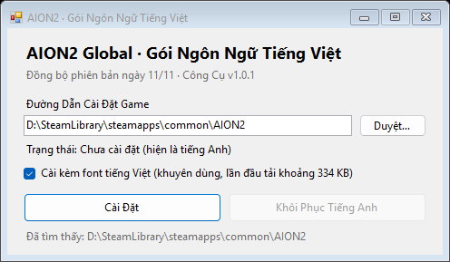

# AION2 Global · Gói Ngôn Ngữ Tiếng Việt

<p align="center">
  
</p>

Gói ngôn ngữ tiếng Việt dành cho **AION2 (Tháp Vĩnh Hằng 2) Global (Steam / PURPLE)**, kèm một công cụ cài đặt gọn nhẹ chỉ với một lần bấm.

- Một file exe, khoảng 4 MB, không cần cài đặt, gói ngôn ngữ đã được nhúng sẵn
- Tự động tìm đường dẫn cài game bản Steam và PURPLE
- Một lần bấm để cài đặt, một lần bấm để khôi phục tiếng Anh
- Tự động kiểm tra phiên bản mới trên GitHub Release khi khởi động, một lần bấm để tải, xác minh, thay thế và khởi động lại
- Hỗ trợ Windows 10 / 11 64-bit

> Gói ngôn ngữ này dành cho bản Global.

## Tải xuống

Vào [**Releases**](https://github.com/yuezhang128/Steam-AION2-Vietnamese/releases/latest) để tải `AION2_VIE.exe`.

## Cách sử dụng

1. Đóng game.
2. Chạy `AION2_VIE.exe`. Công cụ sẽ đọc thông tin cài đặt của Steam trước, rồi quét nền các thư mục `AION2` trên tất cả ổ đĩa (ví dụ bản Steam ở `D:\SteamLibrary\steamapps\common\AION2`, bản PURPLE thường nằm ngay tại `D:\AION2`). **Nếu tìm thấy nhiều thư mục, công cụ sẽ liệt kê để bạn chọn**; bất cứ lúc nào bạn cũng có thể bấm “Duyệt…” để tự chọn thư mục.
3. Bấm “Cài Đặt”, hoàn tất rồi mở game là được.
4. Muốn trở lại tiếng Anh, bấm “Khôi Phục Tiếng Anh”.

Khi khởi động, công cụ cũng kiểm tra GitHub Release xem có phiên bản mới không (so sánh với phiên bản file `AION2_VIE.exe`). Nếu có, công cụ sẽ hỏi bạn có muốn cập nhật không: xác nhận rồi công cụ sẽ tự tải xuống, xác minh bằng SHA-256 đi kèm Release, thay thế chính nó và khởi động lại; sau đó vẫn bấm “Cài Đặt” như bình thường. Nếu không muốn kiểm tra, khởi động với `/noupdate` hoặc đặt biến môi trường `AION2_VIE_NO_UPDATE=1`.

### Về font tiếng Việt

Khi tích chọn “Cài kèm font tiếng Việt”, công cụ sẽ cài font đã tùy chỉnh bổ sung thêm ký tự tiếng Việt, giúp tiếng Việt trong game hiển thị đầy đủ hơn. Font khoảng 334 KB, không được đóng gói trong exe; lần đầu cài sẽ tải từ repository này. Bạn cũng có thể tự tải [`langpack/Aion2Atreia_EN_Bold.ufont`](langpack/Aion2Atreia_EN_Bold.ufont) rồi đặt cạnh exe, công cụ sẽ ưu tiên file có sẵn.

## Lưu ý

- **Cần cài lại sau khi game cập nhật**: bản cập nhật Steam sẽ ghi đè pak ngôn ngữ trở lại tiếng Anh, chỉ cần mở lại công cụ và bấm “Cài Đặt”. Khi phát hiện pak đã được khôi phục, trạng thái sẽ hiển thị “Trạng thái: Game đã khôi phục file gốc. Hãy cài lại.”. Văn bản mới được thêm vào game phải chờ gói ngôn ngữ cập nhật mới có tiếng Việt.
- **Khôi phục tiếng Anh**: khi cài, công cụ sẽ backup file ngôn ngữ tiếng Anh gốc vào `_AION2_VIE_Backup` trong thư mục game, rồi chép trở lại khi bấm “Khôi Phục Tiếng Anh”. Nếu trước đó đã dùng công cụ dịch khác và file gốc không còn, công cụ không thể khôi phục; hãy dùng “Verify integrity of game files” cho AION2 trong Steam. Ngược lại, nếu bản cập nhật game đã khôi phục pak gốc thì không cần bản backup, công cụ sẽ dùng các file gốc hiện có.
- **Cảnh báo antivirus**: exe chưa có chữ ký số, một số antivirus có thể nhận diện nhầm, SmartScreen cũng có thể chặn lần chạy đầu (bấm “More info → Run anyway”); xem nguyên nhân, cách xác minh và nơi báo lỗi tại [Nhận diện nhầm của antivirus](#nhận-diện-nhầm-của-antivirus). Toàn bộ mã nguồn nằm trong repository này, exe trong Release được GitHub Actions build từ mã nguồn.
- **Không có quyền ghi**: nếu game được cài trong thư mục như `Program Files`, hãy chạy công cụ với quyền quản trị.
- **Tự chịu trách nhiệm khi sử dụng**: đây là gói ngôn ngữ không chính thức do người chơi tạo, thay file ngôn ngữ của game và không liên quan tới NCSOFT.

## Nội dung gói ngôn ngữ

- Phiên bản hiện tại đồng bộ với bản game ngày **11/11**, gồm 153.008 mục văn bản.
- Bổ sung bản dịch cho thành tựu, vật phẩm, danh hiệu và giao diện chưa được dịch.
- Các phần chủ ý giữ nguyên tiếng Anh: tên máy chủ, các chữ viết tắt thông dụng như `PVP` / `DPS`, tên công nghệ đồ họa.

Nếu phát hiện lỗi chữ hoặc nội dung chưa dịch, hãy báo tại [Issues](https://github.com/yuezhang128/Steam-AION2-Vietnamese/issues).

## Nhận diện nhầm của antivirus

Một số antivirus có thể nhận diện nhầm công cụ này (thường gặp nhất là Microsoft Defender báo `Trojan:Win32/Wacatac.B!ml`, ngoài ra Avast / AVG / Bitdefender cũng đôi khi gặp). Nguyên nhân là ba đặc điểm kết hợp với nhau khiến công cụ trông giống phần mềm độc hại, nhưng mỗi đặc điểm đều là chức năng cần thiết của công cụ:

- **File thực thi mới chưa ký số**: không có chữ ký số, cũng chưa có uy tín tải xuống, nên mô hình học máy sẽ đánh giá nguy cơ cao.
- **Dữ liệu nhúng có entropy cao**: gói ngôn ngữ là file văn bản game đã mã hóa (AES), entropy gần 8, trông giống một payload độc hại đã được đóng gói.
- **Ghi lại file trong thư mục game**: khi cài, công cụ backup và thay pak ngôn ngữ trong `Aion2\Content\Paks\L10N\Text\en-US\`, hành vi giống các bản “crack game / patch ngôn ngữ”.

### Bạn có thể tự kiểm tra

- Trang Release có kèm `AION2_VIE.exe.sha256`, sau khi tải hãy dùng `certutil -hashfile AION2_VIE.exe SHA256` để đối chiếu.
- Toàn bộ mã nguồn (`AION2_VIE.cs`, `build.bat`, `.github/workflows/release.yml`) nằm trong repository này, exe của Release được GitHub Actions build từ mã nguồn; bạn cũng có thể tự chạy `build.bat` để biên dịch.
- Công cụ không ghi Registry. Các yêu cầu mạng phục vụ kiểm tra và tải bản cập nhật từ GitHub Release (có thể tắt kiểm tra khi mở bằng `/noupdate` hoặc `AION2_VIE_NO_UPDATE=1`), cùng việc tải font khi được chọn.

### SmartScreen chặn (exe chưa ký số có thể gặp)

Khi thấy “**Microsoft Defender SmartScreen đã ngăn một ứng dụng chưa được nhận diện**”:

1. Bấm “**More info**” → “**Run anyway**” để chạy lần này.
2. Nếu không muốn thông báo xuất hiện lại, hãy “Unblock” file trước (SmartScreen kiểm tra file tải xuống dựa vào dấu “đến từ Internet” của file, tức MOTW):

   ```powershell
   Unblock-File .\AION2_VIE.exe          # Hoặc bấm chuột phải → Properties → General → tích “Unblock”
   ```

   Cũng có thể tải bằng dòng lệnh (`Invoke-WebRequest` không thêm MOTW):

   ```powershell
   iwr https://github.com/yuezhang128/Steam-AION2-Vietnamese/releases/latest/download/AION2_VIE.exe -OutFile AION2_VIE.exe
   .\AION2_VIE.exe
   ```

## Nguyên lý hoạt động

Toàn bộ văn bản của game nằm trong bảng “key → văn bản” `L10NString.dat`. Bản Global không có ngôn ngữ tiếng Việt, nên gói ngôn ngữ thay file văn bản của **ngôn ngữ tiếng Anh (en-US)**; game tưởng đang hiển thị tiếng Anh, nhưng thực tế đọc được tiếng Việt.

Khi cài đặt, công cụ thực hiện hai việc:

| Thao tác | File |
|---|---|
| Backup pak ngôn ngữ tiếng Anh gốc rồi thay bằng file rỗng để game đọc gói tiếng Việt | `Aion2\Content\Paks\L10N\Text\en-US\pakchunk502000-Windows_0_P.*` |
| Tạo và ghi pak chứa bản dịch tiếng Việt, kèm font nếu được chọn | `Aion2\Content\Paks\vietnamese.pak` |

Việc xác định trạng thái chỉ dựa trên **file thực tế** trong thư mục game: MD5 của `vietnamese.pak` có khớp gói tạo từ bản dịch và font được chọn hay không, **đồng thời** pak/IoStore ngôn ngữ en-US đã được thay bằng file giữ chỗ 0 byte (hoặc bị xóa) hay chưa. Thư mục backup `_AION2_VIE_Backup` chỉ dùng để khôi phục tiếng Anh, không tham gia xác định “đã cài hay chưa” — vì game cập nhật sẽ khôi phục pak, nhưng thư mục backup vẫn còn, dùng nó để xác định sẽ báo nhầm “đã cài”.

### Định dạng và mã hóa/giải mã `L10NString.dat`

File ngôn ngữ của game không phải văn bản thuần, mà là một container **nén LZ4 + mã hóa AES-256-ECB** (toàn bộ giá trị dưới đây dùng little-endian):

| Offset | Độ dài | Nội dung |
|---|---|---|
| `0x00` | 4 | Phiên bản, giá trị cố định `2` |
| `0x04` | 16 | Header, làm rối bằng XOR với `header_key` |
| `0x14` | Đến cuối file | Phần thân mã hóa AES-256-ECB (độ dài phải là bội số của 16) |

Header sau khi giải mã gồm bốn `int32`: `lz4_packed_size`, `encryption_type` (cố định `2`), `body_size` (độ dài phần thân sau khi đệm để căn chỉnh 16 byte), `raw_size` (độ dài sau giải nén). Khóa được suy ra bằng BLAKE3:

```python
def h64(b):         return struct.unpack("<Q", blake3.blake3(b).digest()[:8])[0]
def xor(data, key): return bytes(b ^ key[i % len(key)] for i, b in enumerate(data))

seed        = h64(b"L10NString_en-US")                                  # Mỗi ngôn ngữ một bộ
HEADER_ROOT = h64(struct.pack("<Q", 0xCD02190910CE83F6))
header_key  = blake3.blake3(struct.pack("<QQiI", HEADER_ROOT, seed, 3, 0)).digest()   # 32 bytes
aes_key     = KEYS[seed]      # 32 bytes; bảng khóa lấy từ file game, repository này không cung cấp
```

Phần thân sau giải mã = `32` zero byte + LZ4 block (độ dài `lz4_packed_size`) + đệm zero để căn chỉnh 16 byte. Nội dung sau giải nén là một bảng “key → văn bản”:

```text
int32    version = 1
fstring  namespace ("AION2")
int32    entry_count
entry_count × ( fstring key, fstring value )
4 byte zero
```

Quy tắc `fstring`: đầu tiên là `int32 n`; `n == 0` là chuỗi rỗng, `n > 0` nghĩa là tiếp theo có `n` byte UTF-8 kể cả `\0` cuối chuỗi, `n < 0` nghĩa là có `|n|` code unit UTF-16LE kể cả `0x0000` cuối chuỗi.

Quy trình đầy đủ để sửa một dòng văn bản:

1. Đọc file và xác nhận `int32` đầu tiên bằng `2`.
2. Dùng `header_key` XOR `dat[0x04:0x14]` để lấy `lz4_packed_size` / `body_size` / `raw_size`.
3. Dùng `aes_key` giải mã `dat[0x14:]` bằng AES-256-ECB, bỏ qua 32 bytes đầu (prefix của phần thân), rồi giải nén LZ4 thành `raw`.
4. Phân tích bảng đối chiếu và sửa văn bản. **Thay thế cùng độ dài (ví dụ “start” → “begin”, “exit” → “quit”) không làm thay đổi `raw_size`**, header chỉ cần thay các trường kích thước.
5. Tạo lại theo thứ tự ngược: `raw` → LZ4 (`lz4.block.compress(raw, mode="high_compression", store_size=False)`) → thêm prefix 32 bytes ở đầu → đệm zero để căn chỉnh 16 byte → AES-256-ECB.
6. Header mới = các giá trị kích thước mới XOR với **cùng `header_key`** (seed của ngôn ngữ không đổi), thêm `02 00 00 00` ở đầu rồi ghi lại.

> Prefix 32 bytes ở đầu phần thân: trước 2026-10-09, file chính thức dùng 32 byte zero; sau đó đổi thành 32 bytes metadata (AES key không đổi). Khi tạo lại, **giữ nguyên prefix của file chính thức** là an toàn nhất.

```python
# Chỉ cần ba thư viện pycryptodome, lz4 và blake3
def decrypt(dat, locale="en-US"):
    seed = h64(f"L10NString_{locale}".encode())
    packed, etype, aligned, rawsize = struct.unpack("<iiii", xor(dat[4:20], header_key(seed)))
    assert dat[:4] == struct.pack("<I", 2) and etype == 2 and aligned == len(dat) - 20
    dec = AES.new(KEYS[seed], AES.MODE_ECB).decrypt(dat[20:20 + aligned])
    return lz4.block.decompress(dec[0x20:0x20 + packed], uncompressed_size=rawsize)  # -> raw

def encrypt(raw, locale="en-US", prefix=None):
    seed = h64(f"L10NString_{locale}".encode())
    packed = lz4.block.compress(raw, mode="high_compression", store_size=False)
    body = (prefix or bytes(0x20)) + packed          # prefix nên giữ nguyên giá trị từ file chính thức
    body += bytes(-len(body) % 16)
    header = xor(struct.pack("<iiii", len(packed), 2, len(body), len(raw)), header_key(seed))
    return struct.pack("<I", 2) + header + AES.new(KEYS[seed], AES.MODE_ECB).encrypt(body)
```

Sau khi sửa gói ngôn ngữ, nhớ chạy lại `build.bat` để nhúng `L10NString.dat` mới vào exe.

## Build từ mã nguồn

Không cần cài bất kỳ công cụ phát triển nào, sử dụng trình biên dịch .NET Framework có sẵn trong Windows:

```bat
build.bat
```

Lệnh sẽ tạo `AION2_VIE.exe` trong cùng thư mục và nhúng `langpack\L10NString.dat` vào đó. Sau khi cập nhật gói ngôn ngữ, chỉ cần chạy lại một lần.

| File | Mô tả |
|---|---|
| `AION2_VIE.cs` | Mã nguồn công cụ cài đặt (C# / WinForms) |
| `build.bat` | Script build |
| `langpack/L10NString.dat` | Gói ngôn ngữ tiếng Việt |
| `langpack/Aion2Atreia_EN_Bold.ufont` | Font tiếng Việt (Atreia đã tùy chỉnh) |

Công cụ cũng hỗ trợ dòng lệnh:

```bat
AION2_VIE.exe /install "D:\SteamLibrary\steamapps\common\AION2" [/nofont]
AION2_VIE.exe /uninstall "D:\SteamLibrary\steamapps\common\AION2"
AION2_VIE.exe /scan
AION2_VIE.exe /checkupdate
AION2_VIE.exe /update [/norestart]
```

`/scan` chỉ liệt kê các thư mục AION2 được tự động tìm thấy (trả về 2 nếu không tìm thấy), giúp kiểm tra kết quả nhận diện.
`/checkupdate` chỉ báo phiên bản (trả về 0 nếu đã mới nhất, 1 nếu có bản mới, 2 nếu kiểm tra thất bại); `/update` tải xuống và tự cập nhật (`/norestart` nghĩa là không tự khởi động lại sau khi cập nhật). GUI cũng có thể dùng `/noupdate` để bỏ qua kiểm tra cập nhật khi khởi động.

## Nguồn gốc

Công cụ này được phát triển từ [Steam-AION2-TraditionalChinese](https://github.com/Monohitoxx/Steam-AION2-TraditionalChinese) của [Monohitoxx](https://github.com/Monohitoxx), điều chỉnh để cài đặt gói ngôn ngữ tiếng Việt. Xin cảm ơn tác giả đã chia sẻ mã nguồn.
